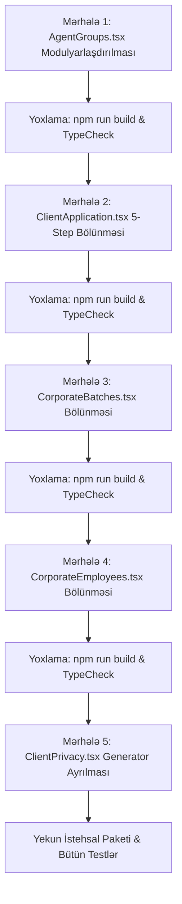

# 🎨 EUROTECH Frontend Memarlığı — Modulyar Refaktorinq Baş Planı

Bu sənəd `front/src/` daxilində **1000–2000 sətri keçmiş monolit səhifə komponentlərinin** ([AgentGroups.tsx](file:///c:/Users/lenovo/Desktop/EUROTECH/front/src/modules/agent/pages/Groups/AgentGroups.tsx), [ClientApplication.tsx](file:///c:/Users/lenovo/Desktop/EUROTECH/front/src/modules/client/pages/Application/ClientApplication.tsx), [CorporateBatches.tsx](file:///c:/Users/lenovo/Desktop/EUROTECH/front/src/modules/corporate/pages/Batches/CorporateBatches.tsx), [CorporateEmployees.tsx](file:///c:/Users/lenovo/Desktop/EUROTECH/front/src/modules/corporate/pages/Employees/CorporateEmployees.tsx), [ClientPrivacy.tsx](file:///c:/Users/lenovo/Desktop/EUROTECH/front/src/modules/client/pages/Privacy/ClientPrivacy.tsx)) ixtisaslaşmış alt komponentlərə (`components/`), fərdiləşdirilmiş hook-lara (`hooks/`), modallara (`modals/`) və köməkçi utilitlərə (`utils/`) bölünməsi üçün hazırlanmış strateji arxitektura planıdır.

---

## 📌 1. Problemin Dərin Təhlili və Skan Nəticələri

Frontend kod bazası (`front/src/`) üzrə aparılan tam skan nəticəsində **26 ədəd 300+ sətirlik**, xüsusən də **5 ədəd 1000–2000+ sətirlik nəhəng monolit fayl** aşkar edilmişdir:

### 🚨 Ən Böyük Monolit Səhifələr (Top 5 Prioritet):

| Səviyyə | Fayl | Sətir Sayı | Əsas Problem və Məzmun |
| :--- | :--- | :--- | :--- |
| **Kritik #1** | [ClientApplication.tsx](file:///c:/Users/lenovo/Desktop/EUROTECH/front/src/modules/client/pages/Application/ClientApplication.tsx) | **2,037 sətir** | 5 mərhələli Şengen anketinin bütün 60+ input sahəsi, validasiyalar, ərizəçi switcher-i, PDF generasiyası bir fayldadır. |
| **Kritik #2** | [AgentGroups.tsx](file:///c:/Users/lenovo/Desktop/EUROTECH/front/src/modules/agent/pages/Groups/AgentGroups.tsx) | **1,844 sətir** | Qrup kartları, KPI statistika, 5 addımlıq Şengen forması, Sənəd yükləmə zonası və 4 fərqli modal eyni yerdədir. |
| **Kritik #3** | [CorporateBatches.tsx](file:///c:/Users/lenovo/Desktop/EUROTECH/front/src/modules/corporate/pages/Batches/CorporateBatches.tsx) | **1,267 sətir** | Korporativ partiyalar, işçi anketləri, Excel import, sənəd checklist və partiya idarəetməsi qarışıqdır. |
| **Kritik #4** | [CorporateEmployees.tsx](file:///c:/Users/lenovo/Desktop/EUROTECH/front/src/modules/corporate/pages/Employees/CorporateEmployees.tsx) | **1,158 sətir** | İşçi cədvəli, Pasport Radarı (30/60/90 gün), Dosye detalları, Əlavə etmə/Redaktə modalları eyni fayldadır. |
| **Kritik #5** | [ClientPrivacy.tsx](file:///c:/Users/lenovo/Desktop/EUROTECH/front/src/modules/client/pages/Privacy/ClientPrivacy.tsx) | **1,141 sətir** | 500+ sətirlik daxili XML SpreadsheetML generatoru, CSV ixrac mühərriki və Anonimləşdirmə modalı daxildədir. |

### ⚠️ İkinci Dərəcəli Böyük Səhifələr (500–900 sətir):
- [CorporateFinance.tsx](file:///c:/Users/lenovo/Desktop/EUROTECH/front/src/modules/corporate/pages/Finance/CorporateFinance.tsx) — **889 sətir** (Büdcə, Fakturalar, Proforma PDF, Balans ödənişi)
- [ClientDashboard.tsx](file:///c:/Users/lenovo/Desktop/EUROTECH/front/src/modules/client/pages/Dashboard/ClientDashboard.tsx) — **853 sətir** (Aktiv dosyelər, addım indikatorları, bildirişlər)
- [AgentFinance.tsx](file:///c:/Users/lenovo/Desktop/EUROTECH/front/src/modules/agent/pages/Finance/AgentFinance.tsx) — **810 sətir** (Pul kisəsi, Komissiya kalkulyatoru, Bank detalları, Çıxarış modalı)
- [ClientDocuments.tsx](file:///c:/Users/lenovo/Desktop/EUROTECH/front/src/modules/client/pages/Documents/ClientDocuments.tsx) — **792 sətir** (Sənəd statusları, drag-drop yükləmə, ailə paylaşımı)
- [ClientServices.tsx](file:///c:/Users/lenovo/Desktop/EUROTECH/front/src/modules/client/pages/Services/ClientServices.tsx) — **761 sətir** (Premium xidmətlər kataloqu, səbət və kalkulyator)
- [ClientAppointment.tsx](file:///c:/Users/lenovo/Desktop/EUROTECH/front/src/modules/client/pages/Appointment/ClientAppointment.tsx) — **665 sətir** (Təqvim, slot seçimi, mərkəz seçimi, görüş bileti PDF)
- [ClientTracking.tsx](file:///c:/Users/lenovo/Desktop/EUROTECH/front/src/modules/client/pages/Tracking/ClientTracking.tsx) — **624 sətir** (Timeline, konsulluq statusları, SMS radar)
- [AgentAppointments.tsx](file:///c:/Users/lenovo/Desktop/EUROTECH/front/src/modules/agent/pages/Appointments/AgentAppointments.tsx) — **574 sətir** (Qrup görüşləri və manifest yükləməsi)

---

## 🏛️ 2. Standart Frontend Komponent və Hook Memarlığı

Hər bir monolit səhifə təmiz və sınaqdan keçmiş **React Komponent Modulyarlaşdırma Standartına** gətiriləcək:

```
front/src/modules/[modul_adi]/pages/[Sehife_Adi]/
├── components/                          # Təmiz, təkrarlanmayan UI vahidləri (hər biri 60-150 sətir)
│   ├── [Sehife]StatsBar.tsx             # Statistika və KPI kartları
│   ├── [Sehife]Toolbar.tsx              # Axtarış, filtr və əsas düymələr
│   ├── [Sehife]ListCard.tsx             # Vahid siyahı kartı / cədvəl sətri
│   ├── [Sehife]DetailView.tsx           # İdarəetmə / Baxış ekranı
│   └── [Sehife]FormSteps.tsx            # Addım-addım anket blokları
├── modals/                              # Ayrılmış və təcrid olunmuş modallar
│   ├── [Modal1].tsx                     # Məs: AddTravelerModal.tsx
│   ├── [Modal2].tsx                     # Məs: ScheduleAppointmentModal.tsx
│   └── [Modal3].tsx                     # Məs: GroupSettingsModal.tsx
├── hooks/                               # Məlumat və biznes məntiqini saxlayan Custom Hook-lar
│   ├── use[Sehife]Data.ts               # API fetch, loading və caching məntiqi
│   └── use[Sehife]Actions.ts            # Submit, silmə, status yeniləmə funksiyaları
├── utils/                               # Helperlər və ixrac generatorları
│   └── [sehife]Export.util.ts
├── [Sehife_Adi].tsx                     # 🛡️ YALNIZ ORCHESTRATOR CONTAINER (~120-180 sətir)
└── [Sehife_Adi].css                     # Stil faylı (100% qorunur)
```

### 🛡️ Qorunma Prinsipləri (Zero UI Regression Guarantee):
1. **Bütün mövcud CSS class adları (`.agent-groups-container`, `.kpi-card`, və s.) 100% saxlanılır.** UI dizaynında, rənglərdə və ya spacing-də heç bir fərq yaranmır.
2. **TypeScript tipləri (`export interface ...`) mərkəzi `types.ts` faylından export olunur**, beləliklə digər faylların `import { Group, Applicant } from './AgentGroups'` asılılıqları qırılmır.
3. **Container səhifə sadəcə state-ləri birləşdirir və alt komponentlərə props ötürür.**

---

## 🗂️ 3. Əsas Monolit Səhifələrin Detallı Parçalanma Sxemi

---

### 💼 HƏDƏF 1: `AgentGroups.tsx` (1,844 sətirdən 6 təmiz fayla)

Hazırda `AgentGroups.tsx` daxilində:
- 120 sətir state və interfeyslər
- 400 sətir API əlaqələri, yükləmələr və submit funksiyaları
- 100 sətir KPI kartları
- 300 sətir Qrup siyahı kartları və hər kartın daxili cədvəli
- 500 sətir 5 addımlıq Şengen anket redaktoru
- 250 sətir Sənəd yoxlama və upload dropzone-u
- 200 sətir 4 ədəd modal (Settings, Add Traveler, Appointment, Payment)

#### Yeni Qovluq Strukturu:
```
front/src/modules/agent/pages/Groups/
├── components/
│   ├── AgentGroupsStats.tsx            # KPI kartları (~80 sətir)
│   ├── AgentGroupsToolbar.tsx          # Axtarış, filtr və Roster yükləmə (~90 sətir)
│   ├── AgentGroupCard.tsx              # Qrup kartı, sərnişin siyahısı və aksiyalar (~160 sətir)
│   ├── AgentTravelerFormEditor.tsx     # 5 addımlı Şengen forması (~240 sətir)
│   └── AgentTravelerDocsChecklist.tsx  # Sənəd tələbləri və upload dropzone (~150 sətir)
├── modals/
│   ├── AddTravelerModal.tsx            # Sərnişin əlavə etmə modalı (~110 sətir)
│   ├── GroupAppointmentModal.tsx       # Qrup görüş təyini modalı (~90 sətir)
│   ├── GroupPaymentModal.tsx           # Ödəniş statusu modalı (~70 sətir)
│   └── GroupSettingsModal.tsx          # Qrup adı/redaktə modalı (~70 sətir)
├── hooks/
│   └── useAgentGroups.ts               # Qrupların çəkilməsi, filterlər və əməliyyatlar (~140 sətir)
├── types.ts                            # Group, Applicant, ApplicantDoc tipləri (~60 sətir)
├── AgentGroups.tsx                     # Əsas Container səhifə (~130 sətir)
└── AgentGroups.css                     # Mövcud stil faylı
```

---

### 📝 HƏDƏF 2: `ClientApplication.tsx` (2,037 sətirdən 7 təmiz fayla)

Hazırda layihənin **ən böyük frontend faylıdır**. B2C müştərilərinin 5 mərhələli Şengen ərizəsini ehtiva edir.

#### Yeni Qovluq Strukturu:
```
front/src/modules/client/pages/Application/
├── components/
│   ├── Step1Plans.tsx                  # Səfər məqsədi, ölkələr, tarixlər, giriş sayı (~180 sətir)
│   ├── Step2Personal.tsx               # Şəxsi məlumatlar, FIN, qəyyum, vətəndaşlıq (~220 sətir)
│   ├── Step3Passport.tsx               # Xarici pasport detalları, digər yaşayış icazələri (~160 sətir)
│   ├── Step4Stay.tsx                   # Dəvət edən tərəf, otel, xərclərin qarşılanması (~210 sətir)
│   ├── Step5Contacts.tsx               # Yaşayış ünvanı, iş yeri, telefon, e-poçt (~170 sətir)
│   └── ApplicationHeader.tsx           # Ərizəçi vərəqləri (tabs), proqres barı, PDF düyməsi (~90 sətir)
├── hooks/
│   └── useApplicationForm.ts           # Avtomatik qaralama (auto-save), submit və validasiya (~160 sətir)
├── types.ts                            # ApplicantData, FormValues tipləri
├── ClientApplication.tsx               # Orchestrator (~120 sətir)
└── ClientApplication.css
```

---

### 🏢 HƏDƏF 3: `CorporateBatches.tsx` (1,267 sətirdən 6 təmiz fayla)

B2B Korporativ tərəfdaşların ezamiyyət partiyalarını idarə etdiyi mühüm səhifə.

#### Yeni Qovluq Strukturu:
```
front/src/modules/corporate/pages/Batches/
├── components/
│   ├── CorporateBatchCard.tsx          # Partiya kartı, əməkdaş statusları (~150 sətir)
│   ├── CorporateBatchToolbar.tsx       # Filtr, axtarış və partiya yaratma (~90 sətir)
│   ├── CorporateEmployeeFormEditor.tsx # İşçi anket redaktoru (~220 sətir)
│   └── CorporateBatchDocsChecklist.tsx # Korporativ sənəd tələbləri checklisti (~140 sətir)
├── modals/
│   ├── CreateBatchModal.tsx            # Yeni partiya yaratma modalı (~100 sətir)
│   └── BatchSettingsModal.tsx          # Partiya redaktəsi modalı (~70 sətir)
├── hooks/
│   └── useCorporateBatches.ts          # Partiya məlumatları və əməliyyat hook-u (~130 sətir)
├── types.ts
├── CorporateBatches.tsx                # Əsas Container (~120 sətir)
└── CorporateBatches.css
```

---

### 👥 HƏDƏF 4: `CorporateEmployees.tsx` (1,158 sətirdən 5 təmiz fayla)

Şirkətin bütün əməkdaşlarının reyestri, pasportlarının etibarlılıq radarı və viza tarixçəsi.

#### Yeni Qovluq Strukturu:
```
front/src/modules/corporate/pages/Employees/
├── components/
│   ├── EmployeeRadarBanner.tsx         # Kritik (<90d) və Xəbərdarlıq (<180d) radarı (~90 sətir)
│   ├── EmployeeTable.tsx               # İşçilər cədvəli və filtrasiya (~180 sətir)
│   └── EmployeeDossierView.tsx         # Seçilmiş işçinin viza və sənəd arxivi (~160 sətir)
├── modals/
│   ├── AddEmployeeModal.tsx            # Yeni işçi əlavə etmə modalı (~110 sətir)
│   └── EditEmployeeModal.tsx           # İşçi məlumatlarını redaktə etmə (~100 sətir)
├── hooks/
│   └── useCorporateEmployees.ts        # İşçi CRUD və pasport statusu hesablama hook-u (~120 sətir)
├── types.ts
├── CorporateEmployees.tsx              # Əsas Container (~110 sətir)
└── CorporateEmployees.css
```

---

### 🔒 HƏDƏF 5: `ClientPrivacy.tsx` (1,141 sətirdən 4 təmiz fayla)

GDPR Məlumat İxracı (Excel, CSV, PDF) və Hesabın Silinməsi səhifəsi. Faylın 550 sətri sadəcə XML Spreadsheet şablon kodudur.

#### Yeni Qovluq Strukturu:
```
front/src/modules/client/pages/Privacy/
├── utils/
│   ├── privacyExcelExport.util.ts      # Multi-sheet XML SpreadsheetML generatoru (~350 sətir)
│   └── privacyCsvExport.util.ts        # UTF-8 BOM ilə CSV ixrac mühərriki (~120 sətir)
├── components/
│   ├── PrivacyRightsCard.tsx           # GDPR Maddə 15 və 20 izahat kartları (~80 sətir)
│   └── PrivacyExportActions.tsx        # Excel, CSV, PDF yükləmə düymələri və statusları (~100 sətir)
├── modals/
│   └── AnonymizeAccountModal.tsx       # Təsdiqləmə və ad yoxlama modalı (~110 sətir)
├── ClientPrivacy.tsx                   # Əsas Container (~100 sətir)
└── ClientPrivacy.css
```

---

## 🚀 4. Mərhələli İcra Planı (Step-by-Step Implementation)

Hər addımdan dərhal sonra `tsc -b && vite build` (`npm run build`) icra olunacaq və sistemdə 0 TypeScript xətasının olması təmin ediləcək.



---

## 🎯 Planın Xülasəsi

Bu plan icra edildikdən sonra:
1. **Frontend-də 1000+ sətirlik heç bir fayl qalmayacaq.**
2. Hər bir fayl **70–240 sətir** arasında təmiz, təcrid olunmuş və oxunaqlı olacaq.
3. Hər bir form mərhələsi (Step 1, Step 2...) müstəqil komponent olaraq təkrar istifadə edilə biləcək.
4. Bütün mövcud CSS stilləri, vizual görünüş və funksionallıq **100% toxunulmaz qalacaq**.
